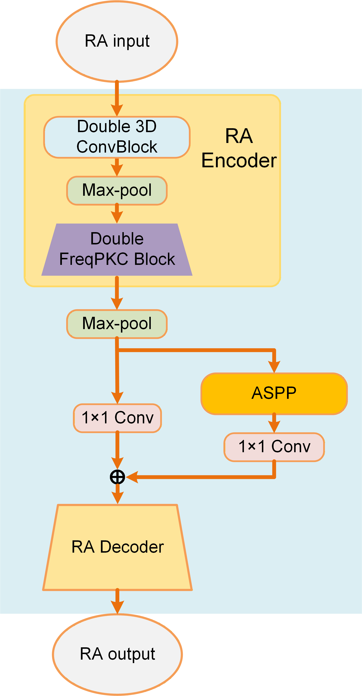
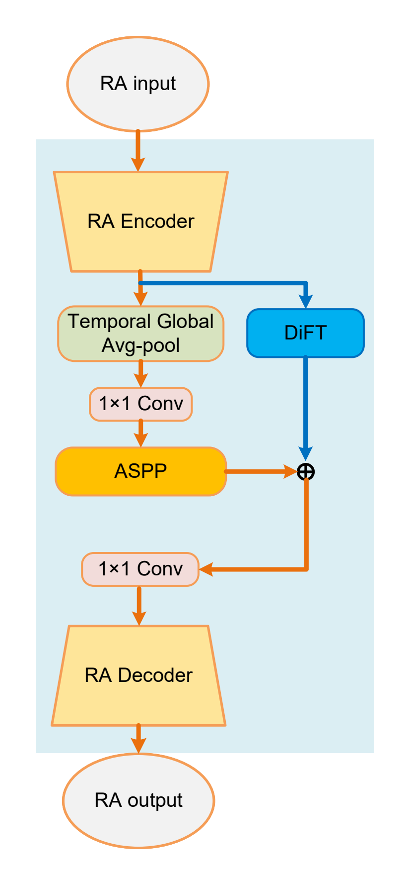
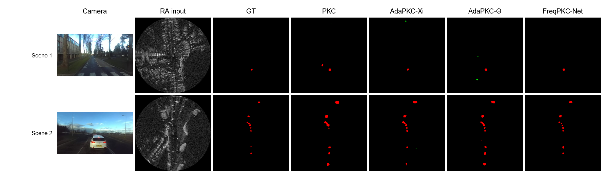
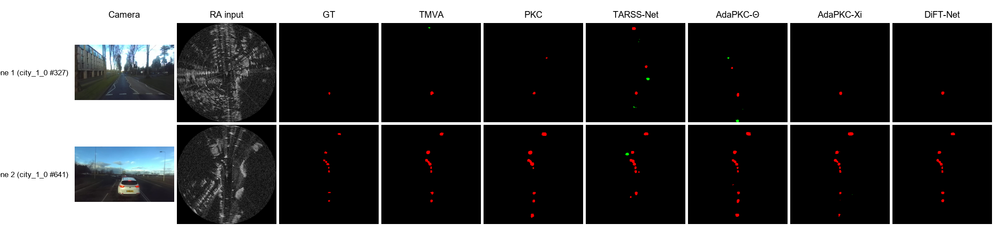

# RS-SAR: Single-View Radar Semantic Segmentation

This repository provides single-view (**range-angle**, RA-only) implementations,
training configurations, and training/testing pipelines for radar semantic
segmentation on the **RS-SAR** dataset. It hosts the two headline methods —

- **FreqPKC-Net** — *FreqPKC: Frequency-Aware PeakConv for Radar Semantic Segmentation*
- **DiFT-Net** — *DiFT: Dive into Frequency-Temporal Learning for Radar Semantic Segmentation*

— together with the SV-Net family (PKC, AdaPKC-Θ, AdaPKC-Xi, MVA, TMVA baselines)
and two single-view TARSS-Net adaptations, all sharing one training framework.

## Model Zoo

Every model consumes a stack of 5 consecutive range-angle frames
`(B, 1, 5, 288, 288)` and predicts a per-pixel mask over 3 classes
(background, small vehicle, large vehicle).

- **SVNet_PKC** (`svnet_pkc.json`, 1.25M) — PeakConv with fixed guard band
- **SVNet_AdaPKCXi** (`svnet_adapkcxi.json`, 1.25M) — metric-based adaptive guard band, pure PyTorch (FiTOS via `threshold`)
- **SVNet_AdaPKCTheta** (`svnet_adapkctheta.json`, 1.25M) — learned guard bandwidth via BandEst
- **SVNet_MVA** (`svnet_mva.json`, 1.30M) — baseline: plain 2D conv, frames-as-channels
- **SVNet_TMVA** (`svnet_tmva.json`, 1.20M) — baseline: 3D conv temporal backbone
- **TARSSNet_V1** (`tarssnet_v1.json`, 2.34M) — spatial-squeeze TAM, channel attention over time
- **TARSSNet_V2** (`tarssnet_v2.json`, 2.29M) — channel-squeeze TAM, spatial attention over time
- **SVNet_FreqPKC** (`svnet_freqpkc.json`, 1.27M) — **FreqPKC-Net**: frequency-decoupled, band-modulated guard bandwidth
- **DiFTNet_S_v2** (`diftnet_s_v2.json`, 2.30M) — **DiFT-Net S**: Spatio-DiFT (LSI + GDSE)
- **DiFTNet_D_v2** (`diftnet_d_v2.json`, 2.38M) — **DiFT-Net D**: Depth-DiFT (channel-wise LSI + GDSE)

## Method Overview

**FreqPKC-Net** builds on PeakConv, the peak-receptive-field convolution for
radar signals. Its frequency-aware module decouples the feature spectrum into
sub-bands, scales each band with learnable weights, and turns the modulated
features into per-pixel guard-bandwidth offsets that steer the peak receptive
field — enhancing high-frequency target details while low-passing background
clutter.

<p align="center">
  
</p>

*Single-view FreqPKC-Net architecture for the RS-SAR dataset.*

**DiFT-Net** addresses the implicit DC-preserving low-pass bias of multi-frame
temporal aggregation with two cascaded frequency-domain mechanisms:
**LSI** (Local Spectral Inversion), which recovers attenuated high-frequency
motion cues via attention-driven temporal mask inversion, and
**GDSE** (Global Dynamic Spectral Equalization), which applies phase-preserving
amplitude modulation across the full band via 1D FFT. The `_S` variant performs
local inversion spatially; the `_D` variant performs it channel-wise. Temporal
aggregation uses learnable weighted compression (v2.1).

<p align="center">
  
</p>

*Single-view DiFT-Net$^{\textit{sv}}$ architecture tailored for the RS-SAR dataset.*

## Qualitative Results

Qualitative segmentation results on two RS-SAR scenes, from the FreqPKC paper
(columns: camera, range-angle input, ground truth, PKC, AdaPKC-Xi, AdaPKC-Θ,
FreqPKC-Net):

<p align="center">
  
</p>

And from the DiFT paper (columns: camera, range-angle input, ground truth,
TMVA, PKC, TARSS-Net, AdaPKC-Θ, AdaPKC-Xi, DiFT-Net; rows are frames #327 and
#641 of sequence `city_1_0`):

<p align="center">
  
</p>

## Installation

The code is developed and tested on **Linux** with **Python 3.9** and
PyTorch 2.7.1 / CUDA 12.6.

```bash
# 1. Create and activate the environment
conda create -n rs_sar python=3.9
conda activate rs_sar

# 2. Install PyTorch via conda (not in requirements.txt)
conda install pytorch==2.7.1 torchvision==0.22.1 torchaudio==2.7.1 cudatoolkit=12.6 -c pytorch -c conda-forge

# 3. Install this package and its dependencies
pip install -e .
pip install -r requirements.txt
```

## Data Preparation

Set the dataset and logs paths **once per machine** (stored in
`rs_sar/config_files/config.ini`):

```bash
cd rs_sar/utils
python set_paths.py --rs-sar /path/to/RS-SAR --logs /path/to/logs
```

The dataset root is expected to contain:

```
RS-SAR/
  data_seq_ref.json                  # per-sequence split (Train/Validation/Test)
  light_dataset_frame_oriented.json  # per-sequence frame lists
  <sequence>/range_angle_numpy/*.npy    # RA frames, 288x288
  <sequence>/annotations/<frame>/range_angle.npy   # GT mask of that frame
```

Each training sample stacks `nb_input_channels` consecutive frames; the mask is
the annotation of the newest frame of the window. Global min/max statistics for
TVT normalization and per-class weights are precomputed in
`rs_sar/config_files/rs_sar_ra_stats_all.json` and `rs_sar_ra_weights.json`.

## Training

```bash
cd rs_sar
bash train.sh   # edit --cfg inside to select the model config
```

Training writes to `{logs}/RS-SAR/{model}/{model}_e{epochs}_lr{lr}_s{seed}_{version}_{timestamp}/`:
`results/` holds the best validation-Dice checkpoint (`val_angle_model.pt`),
the best test-Dice checkpoint (`test_angle_model.pt`), and the resumable full
state (`latest_model.pt`); `boards/` holds TensorBoard logs.

Key config fields (`rs_sar/config_files/*.json`):

- `model` — model name (must match a `MODELS` entry in `train.py`/`test.py`)
- `dataset` — `"RS-SAR"`
- `nb_input_channels` — number of stacked RA frames (5)
- `w_size` / `h_size` — input resolution (288×288)
- `custom_loss` — `ce`, `wce`, `focal`, `nbs1`, `nbs2`, `nbsfocal`, `sdice`, `gendice`, `ce_sdice`, `wce_w10sdice`, `wfocal_w<X>sdice`
- `norm_type` — `local` (per-batch min-max), `tvt` (global min-max), `std` (z-score)
- `schedular` — `cos` (cosine, `Tmax`-1) or `exp` (exponential, every `lr_step` epochs)
- `transformations` — `hflip,vflip` (train-only, 50% each)
- `threshold` — AdaPKC-Xi only: `0` = raw metric selection, `> 0` = FiTOS confidence gating
- `resume_path` — path to a `latest_model.pt` to resume training

## Testing

```bash
cd rs_sar
bash test.sh   # edit --cfg and --model-path first
```

`test.py` evaluates the Test split, saves mask visualizations under
`{logs}/range_angle/{sequence}/`, and writes metrics (pixel accuracy,
precision, recall, mIoU, Dice, false-alarm rate, confusion matrix) to
`test_results.json` next to the model weights.

## Visualization

```bash
python visualize_sequence.py --cfg config_files/diftnet_s_v2.json \
    --model-path /path/to/model.pt --sequence city_1_0
# or ground truth only:
python visualize_sequence.py --cfg config_files/diftnet_s_v2.json \
    --sequence city_1_0 --gt-only
```

## Adding a Model

1. Put the model file in `rs_sar/models/` and export the class from
   `rs_sar/models/__init__.py`.
2. Register it in the `MODELS` dict of `rs_sar/test.py`, the if/elif chain of
   `rs_sar/train.py`, and the `model_cls` dict of `rs_sar/visualize_sequence.py`.
3. Add a config JSON in `rs_sar/config_files/` with the same `model` key.

All supported models must accept `(n_classes, n_frames, dataset_type)` and
return per-pixel logits of shape `(B, n_classes, H, W)` from a
`(B, 1, n_frames, H, W)` input.

## License

This project is released under the [Apache 2.0 license](LICENSE).

## Acknowledgements

This codebase builds on [MVRSS](https://arxiv.org/abs/2103.16214) and the
TARSS-Net codebase. The RS-SAR dataset was collected by the authors.
